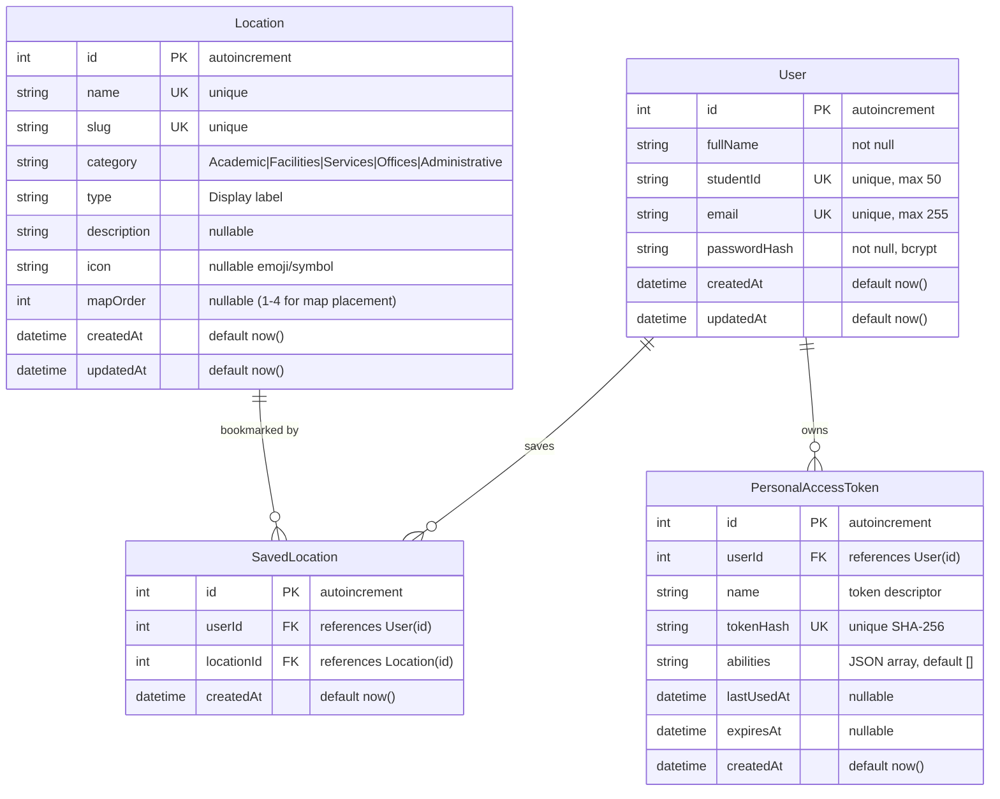

# LdcuNav Database Architecture & Schema Specification

This document provides the definitive specification for the **LdcuNav** database layer, including schema definitions, entity relationships, migration workflows, indexing strategies, and database seeders.

---

## 1. Architectural Overview

LdcuNav uses **PostgreSQL** as its relational database management system, paired with **Prisma ORM** as the schema definition and migration engine, and a custom **Laravel PDO Data Access Client** (`App\Prisma\PrismaClient` and `App\Prisma\ModelQuery`) at runtime.

```
┌─────────────────────────┐
│     Vue 3 Frontend      │
└────────────┬────────────┘
             │ HTTP REST (Bearer Token)
┌────────────▼────────────┐
│   Laravel 12 Backend    │
│  (Routing, Auth, Rules) │
└────────────┬────────────┘
             │ App\Prisma\PrismaClient (PDO Prepared Statements)
┌────────────▼────────────┐
│   PostgreSQL Database   │ <==== Managed by Prisma Schema & Migrations
│        (ldcunav)        │       (prisma/schema.prisma -> npx prisma migrate)
└─────────────────────────┘
```

### Key Architectural Principles
1. **Single Source of Truth**: `prisma/schema.prisma` is the sole authority for database tables, columns, relations, and indexes.
2. **Prisma-Managed Migrations**: Schema updates are applied strictly via Prisma migration scripts under `prisma/migrations/`. Laravel's default migration directory is intentionally unused to avoid dual-schema divergence.
3. **Type-Safe Runtime Querying**: At runtime, Laravel accesses PostgreSQL using `App\Prisma\PrismaClient`, an injected singleton that compiles Prisma-style queries into parameter-bound PDO prepared statements with strict column whitelist validation.
4. **Referential Integrity**: Cascading foreign keys (`ON DELETE CASCADE`) are enforced at the database level for all user-dependent records (saved locations, personal access tokens).

---

## 2. Entity-Relationship Diagram



---

## 3. Schema Reference

### Table: `User`
Stores campus user credentials, student identifiers, and account timestamps.

| Column | Type | Constraints | Description |
|---|---|---|---|
| `id` | `SERIAL` (`INT`) | `PRIMARY KEY` | Auto-incrementing identifier |
| `fullName` | `TEXT` | `NOT NULL` | Full name of the user |
| `studentId` | `TEXT` | `NOT NULL`, `UNIQUE` | Official student / faculty ID (e.g. `2024-00123`) |
| `email` | `TEXT` | `NOT NULL`, `UNIQUE` | Institutional email (must end with `@liceo.edu.ph`) |
| `passwordHash` | `TEXT` | `NOT NULL` | Bcrypt password hash generated by `Hash::make()` |
| `createdAt` | `TIMESTAMP(3)` | `DEFAULT CURRENT_TIMESTAMP` | Account creation timestamp |
| `updatedAt` | `TIMESTAMP(3)` | `DEFAULT CURRENT_TIMESTAMP` | Last profile update timestamp |

**Indexes & Constraints**:
- Primary Key: `User_pkey (id)`
- Unique Index: `User_studentId_key (studentId)`
- Unique Index: `User_email_key (email)`

---

### Table: `Location`
Stores university campus destinations, buildings, offices, and navigational points of interest.

| Column | Type | Constraints | Description |
|---|---|---|---|
| `id` | `SERIAL` (`INT`) | `PRIMARY KEY` | Auto-incrementing identifier |
| `name` | `TEXT` | `NOT NULL`, `UNIQUE` | Human-readable destination name |
| `slug` | `TEXT` | `NOT NULL`, `UNIQUE` | URL-safe identifier (e.g. `north-academic-cluster`) |
| `category` | `TEXT` | `NOT NULL` | Filter category: `Academic`, `Facilities`, `Services`, `Offices`, `Administrative` |
| `type` | `TEXT` | `NOT NULL` | UI display subtitle (e.g. `Academic Building`, `Medical Facility`) |
| `description` | `TEXT` | `NULLABLE` | Detailed description of programs, offices, and services inside |
| `icon` | `TEXT` | `NULLABLE` | Decorative icon or emoji representing the location |
| `mapOrder` | `INTEGER` | `NULLABLE` | Position index (1 to 4) for buildings rendered on the campus SVG map |
| `createdAt` | `TIMESTAMP(3)` | `DEFAULT CURRENT_TIMESTAMP` | Record creation timestamp |
| `updatedAt` | `TIMESTAMP(3)` | `DEFAULT CURRENT_TIMESTAMP` | Record last modification timestamp |

**Indexes & Constraints**:
- Primary Key: `Location_pkey (id)`
- Unique Index: `Location_name_key (name)`
- Unique Index: `Location_slug_key (slug)`
- B-Tree Index: `Location_category_idx (category)`

---

### Table: `SavedLocation`
Join table maintaining student bookmarked locations with referential integrity.

| Column | Type | Constraints | Description |
|---|---|---|---|
| `id` | `SERIAL` (`INT`) | `PRIMARY KEY` | Auto-incrementing identifier |
| `userId` | `INTEGER` | `NOT NULL`, `FK -> User(id)` | User who bookmarked the location |
| `locationId` | `INTEGER` | `NOT NULL`, `FK -> Location(id)` | Bookmarked destination |
| `createdAt` | `TIMESTAMP(3)` | `DEFAULT CURRENT_TIMESTAMP` | Bookmark timestamp |

**Indexes & Constraints**:
- Primary Key: `SavedLocation_pkey (id)`
- Unique Composite Index: `SavedLocation_userId_locationId_key (userId, locationId)` (prevents duplicate bookmarks)
- Foreign Key: `SavedLocation_userId_fkey` references `User(id)` with `ON DELETE CASCADE ON UPDATE CASCADE`
- Foreign Key: `SavedLocation_locationId_fkey` references `Location(id)` with `ON DELETE CASCADE ON UPDATE CASCADE`
- B-Tree Index: `SavedLocation_userId_idx (userId)`

---

### Table: `PersonalAccessToken`
Stores hashed bearer authentication tokens issued upon login or registration.

| Column | Type | Constraints | Description |
|---|---|---|---|
| `id` | `SERIAL` (`INT`) | `PRIMARY KEY` | Auto-incrementing identifier |
| `userId` | `INTEGER` | `NOT NULL`, `FK -> User(id)` | Token owner |
| `name` | `TEXT` | `NOT NULL` | Token identifier (e.g. `auth`) |
| `tokenHash` | `TEXT` | `NOT NULL`, `UNIQUE` | SHA-256 hash of the plaintext token string |
| `abilities` | `TEXT` | `DEFAULT '[]'` | JSON-encoded permission array |
| `lastUsedAt` | `TIMESTAMP(3)` | `NULLABLE` | Timestamp of most recent authenticated request |
| `expiresAt` | `TIMESTAMP(3)` | `NULLABLE` | Expiry timestamp (or null for persistent session) |
| `createdAt` | `TIMESTAMP(3)` | `DEFAULT CURRENT_TIMESTAMP` | Issue timestamp |

**Indexes & Constraints**:
- Primary Key: `PersonalAccessToken_pkey (id)`
- Unique Index: `PersonalAccessToken_tokenHash_key (tokenHash)`
- Foreign Key: `PersonalAccessToken_userId_fkey` references `User(id)` with `ON DELETE CASCADE ON UPDATE CASCADE`
- B-Tree Index: `PersonalAccessToken_userId_idx (userId)`

---

## 4. Migration Workflow

Schema management is handled exclusively through Prisma CLI inside `ldcunav-be`.

### Commands
```bash
# Verify schema syntax without modifying the database
npx prisma validate

# Inspect current migration status against PostgreSQL
npx prisma migrate status

# Apply all pending migrations in production or staging (non-interactive)
npx prisma migrate deploy

# Create a new migration after editing prisma/schema.prisma (development only)
npx prisma migrate dev --name <migration_name>

# Regenerate the Prisma Client definition
npx prisma generate
```

### Migration History
- `20260920112852_init`: Initial baseline migration defining `User`, `Location`, `SavedLocation`, and `PersonalAccessToken` tables with primary keys, unique constraints, foreign keys, and indexes.

---

## 5. Seeders and Mock Dataset

The project includes structured, idempotent seeders designed for demonstration, grading, and testing.

### Seeder Hierarchy
- **`DatabaseSeeder`**: Master orchestrator executing:
  1. **`LocationSeeder`**: Seeds 24 campus locations spanning Academic, Facilities, Services, Offices, and Administrative categories.
  2. **`UserSeeder`**: Creates 4 synthetic demonstration accounts with secure bcrypt password hashes.
  3. **`SavedLocationSeeder`**: Generates user-to-location bookmark relationships for demo accounts.

### Seeding Execution
```bash
# Run the master database seeder
php artisan db:seed

# Or run individual seeders
php artisan db:seed --class=LocationSeeder
php artisan db:seed --class=UserSeeder
php artisan db:seed --class=SavedLocationSeeder

# Or use the custom locations artisan command
php artisan ldcunav:seed-locations
```

### Seeder Safety & Idempotency
- **No Data Loss**: Seeders use upsert semantics (`findUnique` by slug or email). They **never drop or truncate** existing tables.
- **Repeatable**: Seeders can be executed multiple times safely without producing duplicate rows or violating unique constraints.

---

## 6. Demonstration Accounts

The following synthetic accounts are pre-configured by `UserSeeder`. All demo accounts share the standard password:

> **Universal Demo Password:** `LdcuNav2026!`

| Full Name | Student / Employee ID | Email | Role / Purpose | Pre-Saved Bookmarks |
|---|---|---|---|---|
| **Maria Clara Santos** | `2024-00123` | `maria.santos@liceo.edu.ph` | Senior Student | North Academic Cluster, University Library, IT Services Lab, Cashier's Office |
| **Juan Dela Cruz** | `2024-00456` | `juan.delacruz@liceo.edu.ph` | Sophomore Student | West Academic Cluster, Rodolsa Hall, University Gymnasium, University Cafeteria |
| **Prof. Clara Reyes** | `2020-00789` | `clara.reyes@liceo.edu.ph` | Faculty Member | North Academic Cluster, Rodolsa Hall, HRMO, Research & Publications |
| **Demo Campus Navigator** | `2025-00999` | `demo.navigator@liceo.edu.ph` | Evaluator Account | Liceo Civic Center, Health Clinic, Registrar's Office, Guidance Center |

*Disclaimer: All demonstration user names, student IDs, and records are synthetic placeholders created solely for academic evaluation.*
